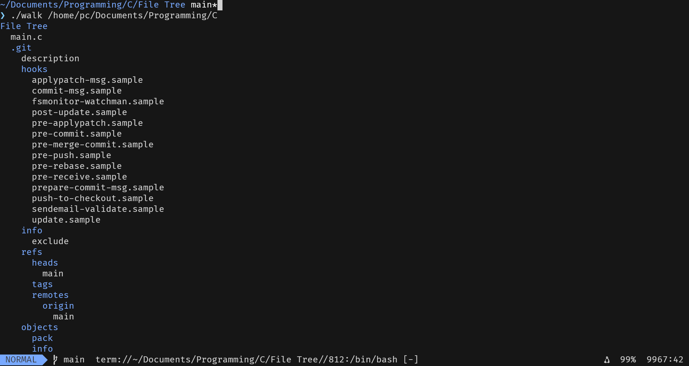

# C Tree Walker

A lightweight command-line utility written in C that recursively traverses directories and prints a visual file tree, mimicking the behavior of the Unix `tree` command. 



## Features

* **Recursive Traversal:** Crawls through directories and subdirectories to map out the file structure.
* **Visual Formatting:** Uses indentation to represent directory depth and ANSI escape codes to highlight directories in **blue**.
* **Robust File Detection:** Uses `dirent.h` for fast file typing, with a built-in fallback to `sys/stat.h` for filesystems that do not support the `d_type` field (returns `DT_UNKNOWN`).
* **Safe Execution:** Automatically ignores `.` (current) and `..` (parent) directories to prevent infinite loops.

## Prerequisites

To compile and run this project, you will need:
* A POSIX-compliant operating system (Linux, macOS, or Windows via WSL/MSYS2).
* A C compiler like `gcc` or `clang`.

## Compilation

Clone the repository and compile the source code using `gcc`:

```bash
git clone [https://github.com/yourusername/c-tree-walker.git](https://github.com/yourusername/c-tree-walker.git)
cd c-tree-walker
gcc walk.c -o walk
```

## Usage
Run the compiled executable. If no path is provided, it defaults to the current working directory (``.``).
**Walk the current directory**
```bash
./walk
```
**Walk a specific directory**
```bash
./walk /path/to/directory
```

## Details
This project was built to demonstrate proficiency in Systems Programming with C. It relies on core POSIX API calls:
- ``opendir()``, ``readdir()``, and ``closedir`` for reading directiry streams.
- ``stat()`` to retrieve file attributes when the filesystem limits ``dirent`` capabilities.
- Memory management using C99 Variable Length Arrays (VLAs) for dynamic string formatting of directory paths.
